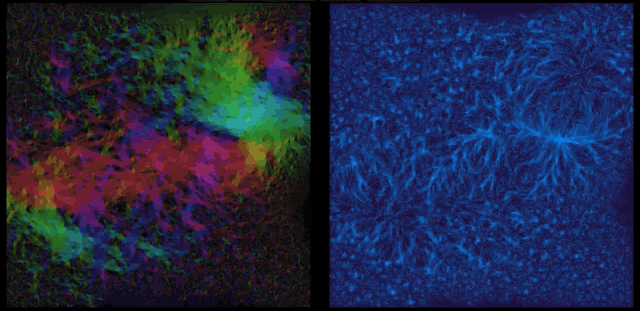

*In Albert's GR there is no rotation -*  
*So drag here to play and get inspiration*  

# Vortex Field

**[▶ Live demo](https://eugene-y.github.io/vortex_field/)** — runs in the browser, needs WebGPU
(recent Chrome or Edge; Safari and Firefox with WebGPU enabled).



Every pair of fluid cells has an instantaneous center of rotation. Vortex Field is an
interactive visualizer of where those centers pile up, side by side with the flow that
produces them.

- **Field A — velocity.** A 2D Navier–Stokes fluid. Hue is the direction of the flow,
  brightness its speed.
- **Field B — rotation centers.** For every pair of cells at the chosen distance, the two
  velocity normals intersect at the pair's center of rotation; the pair's angular velocity
  is added to the cell where that center lands. Orange is counter-clockwise, blue is
  clockwise, brightness is strength. Only CCW is shown at first — toggle **CW** to see both.

## Controls

| action | effect |
|---|---|
| drag on Field A | push the fluid with the brush |
| double-click on Field B, or **P** over either field | inject the pattern selected in **Inject** at that point |
| click or drag on Field B | focus circle: compute Field B only inside it (the brush radius sets its size); click it again or press **Esc** to clear |
| double-click a slider | reset it to its default |
| **Copy URL** | a link that reproduces the current settings exactly |

Hover any control to see what it does.

**Pair distance** sets which cells are paired (the annulus center, as a fraction of the grid
radius); **Distance delta** sets how wide that ring of pairs is. GPU work grows with the size
of the ring and the grid — **Sample stride** and the focus circle bring it down.

You can also [inspect](https://eugene-y.github.io/vortex_field/?gridSize=512&dampingLoss=1.000e-9&simSpeed=0.251&brushRadius=34.8&brushStrength=500&brushSpeed=1.00&patternScale=0.430&pairDistance=0.0447&distanceDelta=0.00302&showMask=3&sampleStride=1&autoNorm=1&boundary=1&vorticity=18.0&pressureIters=1&pattern=triangle&velBrightness=40&rotBrightness=55&maskCx=139.00&maskCy=261.95&maskR=34.80) a single region this way.

## How it works

Everything runs on WebGPU compute shaders, with no build step (plain ES modules).

- Field A: semi-Lagrangian advection with bicubic Catmull–Rom sampling, vorticity
  confinement, and a 9-point Jacobi pressure solve run several iterations per dispatch in
  workgroup memory. Wrap, Absorb and Reflect boundaries.
- Field B: one thread per cell walks its ring of partner cells. Contributions are summed as
  64-bit fixed-point integers — exact and independent of order — with a per-workgroup cache
  that absorbs vortex cores, where most centers land.

Benchmarks and the measurements behind these choices: [`bench/rotation`](bench/rotation/README.md)
(Field B) and [`bench/fluid`](bench/fluid/README.md) (Field A).

## Run locally

Any static file server works; ES modules do not load from `file://`.

```bash
npx serve .
```
